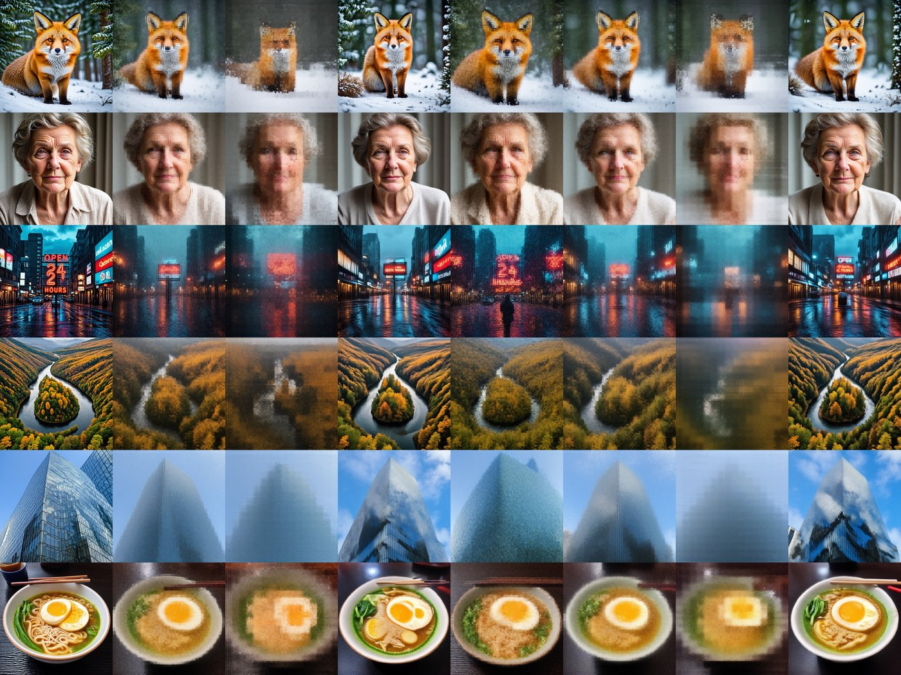
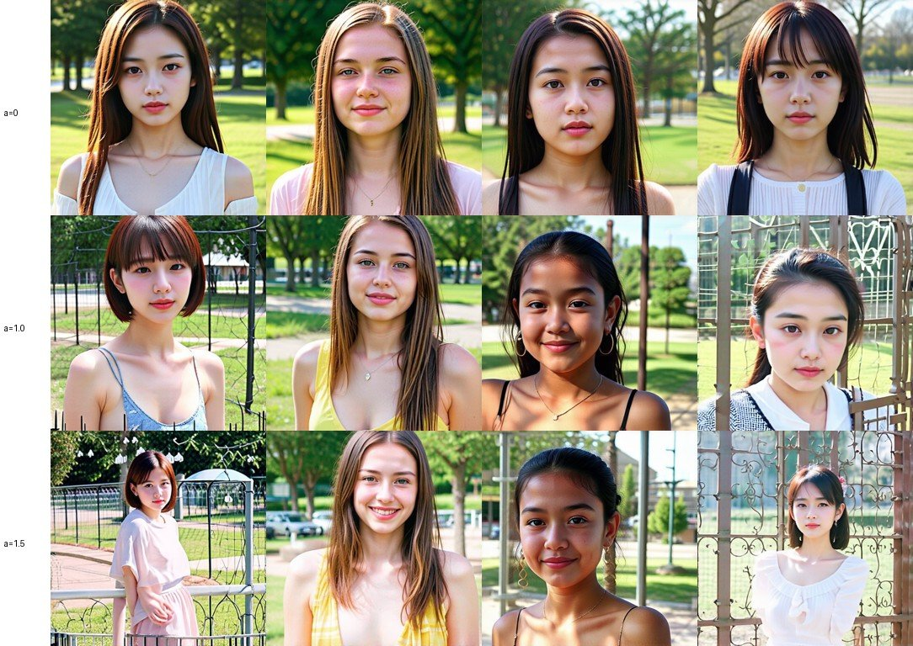

[MobileDiffuser](https://github.com/TWWinde/MobileDiffuser/tree/MCL) is an open-source iOS app that runs a distilled **Stable Diffusion 3 Medium** fully on the iPhone, with the denoiser on the **Apple Neural Engine (ANE)**. It started at 512 × 512. This post is about taking it to **1024 × 1024** on an iPhone 15 Pro, what broke on the way, what did *not* make it faster, and how my [ReSeed](https://twwinde.github.io/reseed-project-page/) adapter runs on device at no measurable cost.

*SD3 Medium, 4 steps, 1024 × 1024, generated with the same Core ML resources the app uses (prompt: "A photo of a red fox in a snowy forest, highly detailed").*

**TL;DR** (iPhone 15 Pro, iOS 18.5, warm runs):

| Model | Resolution | Text | MMDiT | VAE | Total | Peak app memory |
| --- | --- | ---: | ---: | ---: | ---: | ---: |
| SD3-M 2-step | 512 | | | | ~5.6 s | ~86 MB |
| SD3-M 4-step | 512 | 0.7 s | 8.2 s | 0.4 s | ~9.4 s | ~58 MB |
| SD3-M 4-step | 1024 | 0.7 s | 25.2 s | 5.4 s (3×3 tiles) | ~31 s | ~146 MB |

Everything is open: code on [GitHub](https://github.com/TWWinde/MobileDiffuser/tree/MCL), compiled Core ML resources and checkpoints on [Hugging Face](https://huggingface.co/Wenwu2000/MobileDiffuser-SD3-medium), and the app downloads them in-app. There is also a short [demo video](https://www.youtube.com/shorts/m5wlOkeY5Bw).

---

## 1. Why the Neural Engine

On Apple silicon there are two practical routes for a diffusion model:

- **Core ML → ANE.** Ahead-of-time converted, static-shape graphs on a dedicated matrix accelerator. Very fast and power-efficient when the graph fits its rules.
- **MLX → GPU.** Dynamic, flexible, easy to write and debug, any resolution from one set of weights — but a phone GPU is much slower and more power-hungry for this workload.

For a 2B-parameter denoiser on a phone, the ANE is the difference between seconds and minutes, so MobileDiffuser is ANE-first: `computeUnits = .cpuAndNeuralEngine`, no silent GPU/CPU fallback.

The 512 recipe that already worked:

- 4-step and 2-step **DMD-distilled** SD3 Medium students, no CFG (guidance 1.0), flow-matching schedule with shift 3;
- the MMDiT **split into Core ML stages** (conditioning + embeddings + groups of transformer blocks), each loaded and released in turn, so no single ANE program is too large to compile;
- **INT8** linear-symmetric weight quantization for the MMDiT; CLIP-L/G text encoders and the VAE decoder as separate Core ML models.

## 2. Going to 1024: the out-of-memory that wasn't about the model size

The obvious move — convert the same stages with a 128 × 128 latent — failed: a **single** transformer block at 1024 was killed on the iPhone. A block has only ~85M parameters (~85 MB in INT8), so the weights were not the problem.

I built a small probe app that loads one Core ML model on device, queries `MLComputePlan` for per-op placement, and logs latency and `phys_footprint`. It showed what happened:

- With stock `scaled_dot_product_attention`, the ANE compiler **fails** at 4096 + 154 tokens and Core ML quietly places **all ops on the CPU**. Plan + load reach ~4 GB and jetsam kills the app.
- The same model on a Mac reports "all ANE" in `MLComputePlan`. **Placement on the Mac does not transfer to the iPhone** — every decision below was verified on the phone.

What works:

1. **Exact attention with query chunks.** Split the queries into 16 chunks and compute softmax(QKᵀ)V per chunk (no approximation). One 1024 block: **190 ms, 100 % ANE, ~64 MB**.
2. **One transformer block per stage.** Four blocks per stage stalled the on-device ANE compiler for more than 20 minutes (and kept the compiler service busy until a reboot); two blocks work; one block compiles in ~3 s. The full model is 25 stages, ~45 s of one-time compilation, ~1.3 s on later launches.
3. **Tiled VAE decoding.** The existing 512 decoder decodes the 128 × 128 latent as 3 × 3 overlapping 64 × 64 tiles with linear feather blending — no visible seams, no new VAE conversion.

The converted stages match PyTorch at the same level as the released 512 INT8 model (relative L2 ≈ 0.10, cosine ≈ 0.995 with real CLIP conditioning). One gotcha for anyone checking numerics: random N(0, 1) text embeddings overflow fp16 inside SD3 (the text stream exceeds 65,504 after the first block); real CLIP embeddings stay around 25k.

## 3. Where the time goes — and what did not help

Removing attention from a 1024 block drops it from 190 ms to **27 ms**: attention is **~86 %** of the block. The linear layers run at a healthy rate on the ANE; the attention softmax over 24 × 4250 × 4250 elements does not.

Things I measured on the phone that did **not** buy a real speed-up:

| Variant (one 1024 block) | Latency |
| --- | ---: |
| baseline (query chunks 16) | 190–207 ms |
| W8A8 (activations INT8 too) | 199 ms |
| Apple's ANE layout `(B, C, 1, S)` with 1×1 convs | 249 ms |
| per-head split einsum | 192 ms |
| chunks aligned to the image/text boundary | 194 ms |
| keeping all 25 stages resident | app killed after 24 loads |

Training-free **KV downsampling** (ToDo-style average pooling of image keys/values, text keys untouched) *is* fast on the ANE — 67 ms per block at 2 × 2, 48 ms at 4 × 4 — but on a 4-step distilled model it destroys quality. Even with a log(p²) correction for the pooled keys, all-layer pooling turns images foggy and loses text; pooling only the first 12 blocks keeps composition but still loses detail and saves only ~6 s.

*Columns: exact attention · 2×2 all blocks · 4×4 all blocks · 2×2 first 12 blocks · 2×2 last 12 blocks · then the same with the log(p²) correction: 2×2 all, 4×4 all, 2×2 first 12. LPIPS vs exact: 0.82 / 0.95 / 0.60 / 0.66 / 0.86 / 1.02 / 0.62.*

My takeaway: few-step students leave no later steps to correct attention errors, so cheaper attention has to be **trained in** (e.g. pooled or windowed attention in early blocks during distillation), not bolted on afterwards.

## 4. ReSeed on device, for free

Distilled few-step students lose seed diversity: different noises give near-identical images. [ReSeed](https://twwinde.github.io/reseed-project-page/) fixes this with a tiny adapter — a learned per-channel bias added to every transformer block output, **only during the first sampler interval** (72,192 parameters for SD3 Medium).

Because the 1024 model already has one block per stage, every block output is a stage output. So on device:

- the biases for blocks 0–22 are added **between stages** at step 1, in Swift;
- the last block's bias is a small extra input of the final stage (zeros at later steps);
- steps 2–4 are the unchanged student.

The app's 4-step model is the ReSeed student; **one set of weights serves both modes**, and the ReSeed strength α (off / 0.5 / 1.0 / 1.5) is a picker that never reloads the model. Against a PyTorch reference with the paper's hooks, the Core ML chain reproduces the ReSeed effect (a 39 % change of the first-step output) with the usual fp16/INT8 error.

*Same prompt ("A portrait photo of a young woman in a park"), seeds 1–4. Rows: α = 0, 1.0, 1.5. Without ReSeed the four seeds give almost the same frontal portrait; with ReSeed pose, appearance, background and framing vary.*

On the iPhone the 512 ReSeed model runs at **9.4 s** warm — the same as the original 512 model — so the finer split and the bias additions cost nothing measurable.

## 5. What's next

- **FLUX.2 Klein (4B) on the ANE.** Single-block probes run 100 % on the ANE (512: 103 ms double-stream / 119 ms single-stream block), which projects to ~14 s for 4 steps at 512 versus ~71 s with MLX on the GPU. Truncating Klein's 512 padded text tokens to 256 makes each block ~23 % faster with no visible quality change.
- **Training-aware efficient attention** for the high-resolution blocks, and structured pruning of the denoiser, to get 1024 well below 30 s.

## Links

- Code (Core ML / ANE app, converters, probe tools): [github.com/TWWinde/MobileDiffuser (MCL branch)](https://github.com/TWWinde/MobileDiffuser/tree/MCL) — details in `docs/ANE_1024.md` and `docs/RESEED.md`
- Core ML resources and checkpoints: [huggingface.co/Wenwu2000/MobileDiffuser-SD3-medium](https://huggingface.co/Wenwu2000/MobileDiffuser-SD3-medium)
- ReSeed: [project page](https://twwinde.github.io/reseed-project-page/) · [code](https://github.com/TWWinde/ReSeed) · [weights](https://huggingface.co/Wenwu2000/ReSeed)
- Demo video: [YouTube](https://www.youtube.com/shorts/m5wlOkeY5Bw)

MobileDiffuser is joint work with Dong Wang and Olga Saukh; Dong Wang also built the pure-MLX version of the app (Z-Image Turbo and FLUX.2 Klein) on the main branch.
