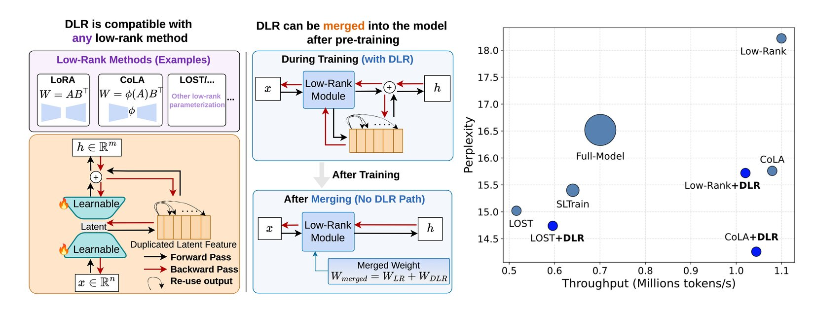

{{ page.authors | markdownify }}

*Under review.*

DLR (Duplicated Latent Residual) improves low-rank pre-training with a structured residual branch that introduces no additional learnable parameters. The branch is folded into the model weights after training, preserving the parameter count, computation, and memory requirements of the low-rank backbone at inference. Experiments cover LLaMA models from 60M to 7B parameters and evaluate both pre-training quality and transfer to supervised fine-tuning.

